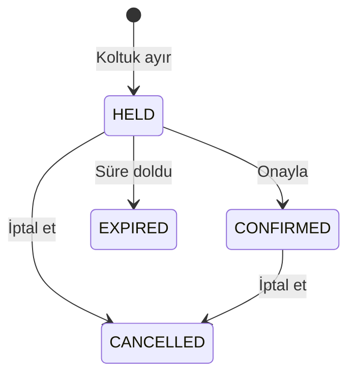

# MOZKAN

**TypeScript, Node.js, Fastify ve PostgreSQL ile rezervasyon ve kapasite yönetimi API'si.**

[Türkçe](#türkçe) | [English](#english)

## Türkçe

MOZKAN, işletmelerin sınırlı kapasiteli etkinlikler oluşturabildiği ve üyelerin koltuk ayırıp rezervasyonlarını onaylayabildiği bir backend portföy projesidir. Sade bir web paneli, API'yi tarayıcıdan denemeyi kolaylaştırır.

Projenin temel problemi son boş koltuğu doğru yönetmektir. Aynı anda gelen istekler kapasiteyi aşmamalı, ağ hatasından sonra tekrar gönderilen bir istek ikinci rezervasyon oluşturmamalı ve süresi dolan rezervasyonlar kapasiteyi serbest bırakmalıdır.

### Özellikler

- Kayıt ve giriş, salt ile scrypt şifre hashleme, 15 dakikalık JWT.
- İşletme bazında `OWNER`, `MANAGER` ve `MEMBER` yetkileri.
- Etkinlik oluşturma, kapasite ve güncel müsaitlik bilgisi.
- Koltuk ayırma, onaylama, iptal ve süre dolumunu işleyen ayrı worker.
- PostgreSQL transaction ve satır kilitleri ile eşzamanlı kapasite kontrolü.
- Tekrarlanan isteklerde çift rezervasyonu önleyen `Idempotency-Key`.
- Yönetici için işletmenin tüm rezervasyonları ve işlem geçmişi.
- İstek doğrulama, açık yanıt şemaları, rate limit, yapılandırılmış loglar ve sağlık uç noktaları.
- Swagger/OpenAPI, gerçek PostgreSQL ile entegrasyon testleri ve GitHub Actions CI.
- Framework gerektirmeyen Türkçe HTML, CSS ve JavaScript paneli.

### Teknolojiler

| Katman           | Teknoloji                                  |
| ---------------- | ------------------------------------------ |
| Çalışma ortamı   | Node.js 24, TypeScript                     |
| HTTP API         | Fastify 5, TypeBox                         |
| Veritabanı       | PostgreSQL 17, `pg`, sürümlü SQL migration |
| Kimlik doğrulama | JWT, Node.js scrypt                        |
| Test             | Node.js test runner, gerçek PostgreSQL     |
| Çalıştırma       | Docker Compose                             |
| Panel            | HTML, CSS, JavaScript                      |

### Yerelde çalıştırma

Gereksinimler: Node.js 24 ve çalışan Docker Engine.

```sh
npm ci
```

`.env.example` dosyasını `.env` olarak kopyalayın:

```powershell
# Windows PowerShell
Copy-Item .env.example .env
```

```sh
# macOS / Linux
cp .env.example .env
```

Aşağıdaki komutla bir anahtar üretip `.env` içindeki `JWT_SECRET` değerini değiştirin:

```sh
node -e "console.log(require('crypto').randomBytes(48).toString('hex'))"
```

Veritabanını başlatın, şemayı ve demo verilerini hazırlayın:

```sh
docker compose up -d db
npm run db:migrate
npm run db:seed
```

API ve worker'ı Docker ile çalıştırın:

```sh
docker compose up --build -d
```

Geliştirme sırasında API için `npm run dev`, ayrı terminalde worker için `npm run dev:worker` kullanabilirsiniz. Docker API'si ile geliştirme API'sini aynı anda başlatmayın; ikisi de 3000 portunu kullanır.

| Adres                                                       | İçerik       |
| ----------------------------------------------------------- | ------------ |
| [localhost:3000](http://localhost:3000/)                    | Web paneli   |
| [localhost:3000/docs/](http://localhost:3000/docs/)         | Swagger UI   |
| [localhost:3000/docs/json](http://localhost:3000/docs/json) | OpenAPI JSON |

Panel API tarafından sunulur ve ek sunucu gerektirmez. PostgreSQL yerelde `127.0.0.1:55432` adresine bağlanır. Migration tamamlandıktan sonra API ve worker başlar.

### Demo hesapları

Her iki hesabın şifresi: `MozkanDemo2026!`

| E-posta             | Rol            |
| ------------------- | -------------- |
| `owner@mozkan.dev`  | İşletme sahibi |
| `member@mozkan.dev` | Üye            |

Panelde demo hesap düğmelerini kullanarak giriş yapın ve demo işletmesini seçin. Etkinlikten koltuk ayırın, ardından **Rezervasyonlarım** bölümünden onaylayın veya iptal edin. İşletme sahibi etkinlik oluşturabilir, kayıtlı kullanıcıları üye olarak ekleyebilir ve yönetim listelerini görebilir. Yöneticiler de etkinlik oluşturabilir ve yönetim listelerini okuyabilir.

Seed, 25 koltuklu ve ilk oluşturulduğu tarihten 14 gün sonra başlayan bir etkinlik ekler. Tekrar çalıştırmak mevcut verileri sıfırlamaz. Demo seed işlemi `NODE_ENV=production` ile çalışmaz. Panel JWT'yi bellekte tutar; sayfayı yenileyince veya token süresi dolunca tekrar giriş gerekir.

### Rezervasyon akışı



Varsayılan bekletme süresi 10 dakikadır ve etkinlik başlangıcını geçmez. Süresi dolan kayıt, worker çalışmasa bile kapasite hesabından hemen çıkar. Worker durumu ve işlem geçmişini veritabanına kaydeder.

Swagger üzerinden denemek için giriş yanıtındaki `accessToken` değerini **Authorize** alanına girin. Ardından şu isteği `Idempotency-Key: demo-reservation-001` başlığıyla gönderin:

```http
POST /api/v1/organizations/00000000-0000-0000-0000-000000000001/reservations
```

```json
{
  "eventId": "00000000-0000-0000-0000-000000000002",
  "seats": 2
}
```

İlk başarılı istek HTTP 201 döner. Aynı anahtar ve içerikle tekrar göndermek aynı rezervasyonu HTTP 200 ve `Idempotency-Replayed: true` başlığıyla döndürür. Aynı anahtarla etkinlik veya koltuk sayısını değiştirmek HTTP 409 üretir. Tekrar yanıtı rezervasyonun güncel durumunu gösterir ve süreyi uzatmaz. İptal veya süre dolumundan sonra yeni rezervasyon için yeni anahtar kullanılır. Başarısız oluşturma istekleri anahtarı tüketmez.

### Ana uç noktalar

Aşağıdaki işletme yollarının öneki `/api/v1/organizations/{organizationId}` şeklindedir.

| Metot      | Yol                                                                             | Erişim                                      |
| ---------- | ------------------------------------------------------------------------------- | ------------------------------------------- |
| POST       | `/api/v1/auth/register`, `/api/v1/auth/login`                                   | Herkese açık                                |
| GET        | `/api/v1/auth/me`                                                               | Giriş yapmış kullanıcı                      |
| POST / GET | `/api/v1/organizations`                                                         | Giriş yapmış kullanıcı                      |
| POST       | `/members`                                                                      | İşletme sahibi                              |
| POST       | `/events`                                                                       | İşletme sahibi veya yönetici                |
| GET        | `/events`, `/events/{eventId}`                                                  | İşletme üyesi                               |
| POST       | `/reservations`                                                                 | İşletme üyesi, idempotency anahtarı gerekli |
| GET        | `/reservations`, `/reservations/{reservationId}`                                | Rezervasyon sahibi                          |
| POST       | `/reservations/{reservationId}/confirm`, `/reservations/{reservationId}/cancel` | Rezervasyon sahibi                          |
| GET        | `/management/reservations`, `/management/audit-logs`                            | İşletme sahibi veya yönetici                |
| GET        | `/health/live`, `/health/ready`                                                 | Herkese açık, tam yollar                    |

Yönetim rezervasyon listesi `eventId` ve `status`, işlem geçmişi `action` filtresini destekler. Her iki liste `limit` ve `offset` ile sayfalanır. Kişisel rezervasyon uç noktaları yalnızca çağıran kullanıcının kayıtlarına erişir; yönetim rolü başkasının rezervasyonunu değiştirme yetkisi vermez.

### Test ve kalite kontrolleri

```sh
npm run check
npm audit --omit=dev
```

`check`, TypeScript kontrolü, biçimlendirme kontrolü, 18 entegrasyon testi ve üretim derlemesini çalıştırır. Testler `_test` ile biten bir veritabanına işaret eden `TEST_DATABASE_URL` gerektirir. Her çalışma ayrı geçici şema oluşturur ve kendi şemasını temizler. Docker ilk veritabanı kurulumunda `mozkan_test` veritabanını oluşturur; CI kendi PostgreSQL servisini kullanır.

Test kapsamı son koltuğa eşzamanlı istekleri, idempotency tekrarlarını ve çakışmalarını, işletme izolasyonunu, rol kontrollerini, rezervasyon sahipliğini, worker kapalıyken süre dolumunu, worker işlemlerini, yönetim filtrelerini, kimlik doğrulamayı ve OpenAPI üretimini içerir.

### Proje yapısı

```text
src/
  app.ts                  # Fastify uygulaması
  server.ts               # HTTP sunucusu ve kapanış
  worker.ts               # Rezervasyon süre dolumu
  config.ts               # Ortam değişkeni doğrulama
  db.ts                   # Bağlantı havuzu ve transaction
  shared/                 # Yetki, hata, şema ve şifreleme yardımcıları
  modules/
    auth/                 # Kayıt ve giriş
    organizations/        # İşletmeler, üyelik ve roller
    events/               # Etkinlikler ve müsaitlik
    reservations/         # Rezervasyon kuralları
    management/           # Yönetim listeleri ve işlem geçmişi
db/migrations/            # Sürümlü SQL migration
scripts/                  # Migration, demo seed ve statik dosya kopyalama
public/                   # Sade web paneli
tests/                    # PostgreSQL entegrasyon testleri
docs/                     # Mimari, başlangıç rehberi ve yol haritası
```

### Kapsam ve kararlar

Bu sürüm belirli başlangıç ve bitiş saatleri olan koltuklu etkinlikleri kapsar. Ödeme, e-posta, bekleme listesi, refresh token ve çakışan oda rezervasyonları henüz uygulanmadı. Rate limit her API sürecinin belleğindedir; birden fazla instance için ortak bir depoya ihtiyaç vardır. Compose bağlantıları ve örnek hesaplar yerel geliştirme içindir.

[Mimari kararlar](docs/ARCHITECTURE.md) | [Türkçe başlangıç rehberi](docs/BASLANGIC.md) | [Yol haritası](docs/ROADMAP.md)

## English

**A reservation and capacity management API built with TypeScript, Node.js, Fastify and PostgreSQL.**

MOZKAN lets organizations publish fixed-capacity events and lets their members hold, confirm or cancel seats. A small Turkish web panel makes the API easy to try. The core challenge is handling the last available seat safely: concurrent requests must respect capacity, retries must not create duplicate bookings, and expired holds must release seats.

### Features

- Registration and login with salted scrypt password hashes and 15-minute JWTs.
- Organization-scoped `OWNER`, `MANAGER` and `MEMBER` permissions checked against the database.
- Events, current availability, time-limited holds, confirmation and cancellation.
- PostgreSQL transactions and row locks for capacity enforcement across API processes.
- Organization- and user-scoped idempotency keys with payload conflict detection.
- A separate expiration worker and transactional reservation audit records.
- Owner and manager reservation lists and audit history with filters and pagination.
- Explicit request and response schemas, structured logs, request IDs, rate limits and health checks.
- Swagger/OpenAPI, real-database integration tests, Docker Compose and GitHub Actions CI.
- A plain HTML, CSS and JavaScript demo served by the API.

### Quick start

Requirements: Node.js 24 and a running Docker Engine.

```sh
npm ci
```

Copy `.env.example` to `.env` using `cp .env.example .env` on macOS/Linux or `Copy-Item .env.example .env` in PowerShell. Generate a secret and replace `JWT_SECRET` in `.env`:

```sh
node -e "console.log(require('crypto').randomBytes(48).toString('hex'))"
docker compose up -d db
npm run db:migrate
npm run db:seed
docker compose up --build -d
```

Open the [web panel](http://localhost:3000/), [Swagger UI](http://localhost:3000/docs/) or [OpenAPI JSON](http://localhost:3000/docs/json). PostgreSQL is exposed locally on port 55432. For development, use `npm run dev` and `npm run dev:worker` in separate terminals instead of running the containerized API on the same port.

Demo accounts are `owner@mozkan.dev` and `member@mozkan.dev`, both with password `MozkanDemo2026!`. The seed creates a 25-seat event starting 14 days after its first seed. Running the seed again preserves existing records. Seeding refuses production mode. The panel keeps tokens in memory, so a page reload or token expiry requires another login.

### Booking rules

Holds last 10 minutes by default, capped at the event start. Expired holds stop consuming capacity even while the worker is offline. The worker persists expiration and its audit record. Availability reads are snapshots; booking checks capacity again under a PostgreSQL lock.

Send `Idempotency-Key` when creating a reservation. The first successful request returns HTTP 201. Repeating the same key and body returns the same reservation in its current state with HTTP 200 and `Idempotency-Replayed: true`. Changing the event or seat count under the same key returns HTTP 409. Replays do not extend holds. A new booking after cancellation or expiration requires a new key. Failed creation requests do not consume keys.

Personal reservation endpoints are scoped to the caller. Owners and managers can read organization-wide bookings and audit history through `/management/reservations` and `/management/audit-logs`, but cannot modify someone else's reservation. Organization paths use the `/api/v1/organizations/{organizationId}` prefix. Management lists support `limit` and `offset`; reservations also support `eventId` and `status`, while audit history supports `action`. See Swagger for the complete API contract.

### Verification

```sh
npm run check
npm audit --omit=dev
```

The check runs strict TypeScript validation, formatting, 18 integration tests and a production build. Tests require `TEST_DATABASE_URL` targeting a database whose name ends in `_test`. They use real PostgreSQL locks and isolated temporary schemas, then clean up their own schema. Docker initializes `mozkan_test` on the first database startup. CI provides its own PostgreSQL service.

Coverage includes concurrent last-seat booking, idempotent retries and conflicts, organization isolation, role permissions, reservation ownership, expiration without the worker, worker processing, management queries, authentication and OpenAPI generation.

### Scope

This version models scheduled events with seats. Payments, email delivery, waitlists, refresh tokens and overlapping room bookings are not implemented. Rate limiting is process-local; multiple API instances need a shared store. Compose credentials and localhost bindings target local development.

The repository includes API modules under `src/modules`, SQL migrations under `db/migrations`, a standalone worker, a browser demo under `public`, integration tests and architecture notes.

[Architecture and decisions](docs/ARCHITECTURE.md) | [Development roadmap](docs/ROADMAP.md)
