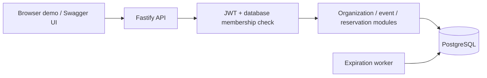
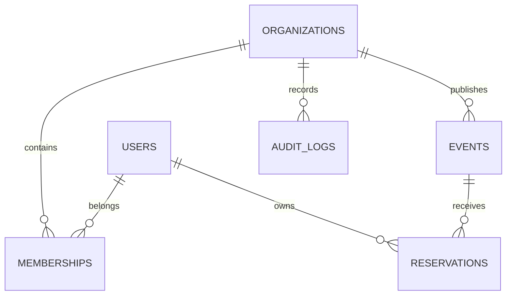
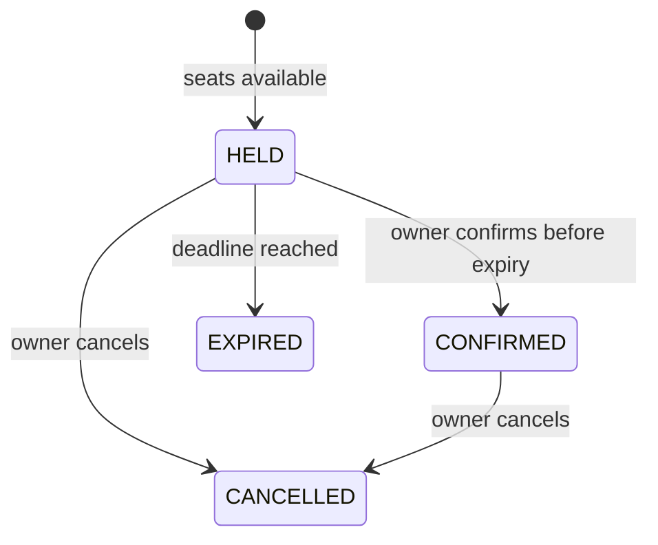

# Architecture and decisions

## Runtime



The API and worker share one database. The application is a modular monolith: module boundaries organize domain code while PostgreSQL provides a single transaction boundary. This keeps deployment and debugging manageable for a junior-plus project.

The small demo is plain HTML, CSS, and JavaScript served from three fixed routes by the same Fastify process. Same-origin requests use the existing API. It keeps access tokens in memory, renders API data as text, and uses the server's organization roles to show available actions. Backend permissions remain authoritative. `npm run build` copies the static files to `dist/public` for the production server.

`buildApp` accepts a database pool so integration tests can run the complete HTTP stack against an isolated PostgreSQL schema. The HTTP process owns its pool when no pool is supplied.

## Data model



Every event and reservation carries an organization ID. A composite foreign key ties each reservation's event ID to its organization, preventing a cross-organization event reference even if an application query is mistaken. Membership checks happen in the HTTP layer, and ownership checks also happen inside reservation mutations.

## Capacity and concurrency

A successful hold follows this transaction:

1. Lock the organization/user/idempotency-key combination using a PostgreSQL transaction advisory lock.
2. Check for an existing reservation with that key. Return it for matching input, or reject different input.
3. Lock the requested event with `SELECT ... FOR UPDATE`.
4. Check its start time and expire elapsed holds for that event.
5. Sum confirmed seats and live held seats, then verify that the new request fits.
6. Insert the hold and its audit record; commit both together.

The event lock serializes capacity decisions across connections and application processes. A database uniqueness constraint backs up idempotency. These controls apply to application writes; direct SQL writes must follow the same capacity protocol.

Confirmation, cancellation, and the worker lock the event before changing reservation rows. The worker uses `SKIP LOCKED` to defer events already being processed, and handles a bounded batch per tick. Expiration and creation use database time for business decisions.

The raw `pg` driver is intentional: the SQL and locking behavior are visible to reviewers. Queries use placeholders for user input. An ORM would be a reasonable alternative, but is unnecessary for this small schema.

## Reservation state



Confirming an already confirmed reservation and cancelling an already cancelled reservation return the same resource. Invalid transitions return HTTP 409. Expired holds are effectively expired in reads and capacity decisions before the worker persists that state. Hold deadlines cannot extend beyond the event start.

Replaying creation returns the current resource, not a frozen copy of the original HTTP response. A replay does not acquire new capacity or extend a deadline. Keys are scoped to organization and user; a hash covers the organization, user, event, and requested seats.

## Access and error behavior

JWTs contain user identity, issuer, audience, and expiration. Roles are read from `memberships`, rather than copied into a token. Passwords use salted scrypt with timing-safe verification. Login failures use one generic response, and missing-user verification also performs password derivation.

Organization outsiders receive 404 so endpoint responses do not disclose organization existence. A member with an insufficient role receives 403. Personal reservation endpoints only expose the caller's own reservations. Separate management read endpoints let owners and managers inspect bookings and audit history for their organization. Their queries retain organization predicates, their responses use explicit schemas, and no management mutation endpoints are added. Expiration audit entries are attributed to automatic processing, rather than to the user whose hold expired. Explicit response schemas prevent password hashes, request hashes, and arbitrary audit metadata from leaking into responses.

Errors follow this shape:

```json
{
  "error": {
    "code": "CAPACITY_EXCEEDED",
    "message": "Event capacity exceeded",
    "requestId": "req-1"
  }
}
```

Unexpected errors are logged on the server and produce a generic HTTP 500. Authorization headers are redacted. Request bodies are not logged. Auth routes use tighter rate limits than general API routes.

## Deliberate limits

No distributed queue is required for expiration; PostgreSQL already holds the state. Notifications would justify an outbox and delivery worker in a later version. No claim of message delivery or exactly-once external side effects is made by this version.

Offset pagination is capped at 100 records per page and uses stable tie-breakers. Cursor pagination is a possible extension when data volumes justify it. The worker is a separate process for independent operation, not a separate domain service.
